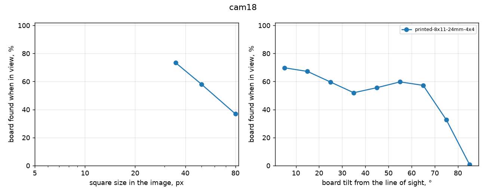

# Calibration board comparison: 18-camera rig: aniposelib vs calibrat3

Made 2026-10-29 20:17 by `scripts/board_study`. All numbers are measured with one detector (OpenCV ChArUco) on every calibration, so they compare across boards and calibration tools, but they are not the numbers calibrat3 or sleap-anipose print. Held-out = recordings (or parts of a recording) the calibration did not use.

## cam18

17 cameras, 1680×1200 px, 10 fps. Recordings: 1 calibration, 0 test.

### Per board

Reprojection and held-out reprojection: median pixels. Ruler error: median error of lengths between far-apart corners of the board, triangulated from held-out frames, % of the length. Board fit: RMS distance of triangulated corners from the printed pattern, mm. 3D spread: how far the same 3D points move between repeated calibrations, mm (median). Camera spread: camera-position spread between repeats, mm. Focal spread: SD of focal length, %. Smallest squares found: 5th percentile of square size, in pixels, among detections. Repeats are separate recordings of one sitting when there are several, else 3 disjoint parts of each recording; with several recordings the spread columns show median (min–max).

| Board | Recordings | Board found | Reprojection | Held-out reprojection | Ruler error | Board fit | 3D spread | Camera spread | Focal spread | Smallest squares found | Steepest tilt found |
|---|---|---|---|---|---|---|---|---|---|---|---|
| printed-8x11-24mm-4x4 | 1 | 40 % | 1.26 px | 1.25 px | 0.479 % | 0.77 mm | 0.36 mm | 2.8 mm | 0.64 % | 49 px | 75° |

### Where each board is still found

Board poses known from the other cameras, fully inside a camera's image: was it found there?

### Repeatability

| Board | Repeats | Engine | 3D spread (median / p95) | Camera position spread (median / worst) | Camera angle spread | Camera distance SD | Focal SD | k1 SD |
|---|---|---|---|---|---|---|---|---|
| printed-8x11-24mm-4x4 | 3 disjoint parts of one recording: cam18-2024-12-06 | anipose | 0.36 / 1.64 mm | 2.8 / 5.6 mm | 0.15° | 2.9 mm | 0.64 % | 0.012 |
| printed-8x11-24mm-4x4 | 3 disjoint parts of one recording: cam18-2024-12-06 | calibrat3 | 0.05 / 0.25 mm | 0.2 / 0.5 mm | 0.08° | 0.2 mm | 0.05 % | 0.003 |

### Calibration tools on the same recordings

| Recording | Tool | Reprojection | Held-out reprojection | Ruler error | Board fit |
|---|---|---|---|---|---|
| cam18-2024-12-06 | anipose | 1.26 px | – | – | – |
| cam18-2024-12-06 | calibrat3 | 0.46 px | – | – | – |
| cam18-2024-12-06 | reference | 1.49 px | – | – | – |

### Calibration tools on the same parts of each recording

Each tool calibrated the same disjoint parts; each part is scored on the others. Medians over parts; spreads are between the parts' calibrations.

| Recording | Tool | Reprojection | Held-out reprojection | Ruler error | Board fit | 3D spread | Camera position spread |
|---|---|---|---|---|---|---|---|
| cam18-2024-12-06 | anipose (3 parts) | 1.09 px | 1.25 px | 0.479 % | 0.77 mm | 0.36 mm | 2.8 mm |
| cam18-2024-12-06 | calibrat3 (3 parts) | 0.45 px | 0.46 px | 0.127 % | 0.20 mm | 0.05 mm | 0.2 mm |

### Recordings

| Recording | Board | Length | Board found per camera |
|---|---|---|---|
| cam18-2024-12-06 (calibration) | printed-8x11-24mm-4x4 | 180 s | 40, 53, 40, 42, 37, 40, 38, 50, 54, 43, 40, 38, 54, 36, 43, 40, 40 % |

