# Calibration board comparison: Existing recordings

Made 2026-10-29 06:17 by `scripts/board_study`. All numbers are measured with one detector (OpenCV ChArUco) on every calibration, so they compare across boards and calibration tools, but they are not the numbers calibrat3 or sleap-anipose print. Held-out = recordings (or parts of a recording) the calibration did not use.

## cam18

17 cameras, 1680×1200 px, 10 fps. Recordings: 2 calibration, 0 test.

### Per board

Reprojection and held-out reprojection: median pixels. Ruler error: median error of lengths between far-apart corners of the board, triangulated from held-out frames, % of the length. Board fit: RMS distance of triangulated corners from the printed pattern, mm. 3D spread: how far the same 3D points move between repeated calibrations, mm (median). Camera spread: camera-position spread between repeats, mm. Focal spread: SD of focal length, %. Smallest squares found: 5th percentile of square size, in pixels, among detections. Repeats are separate recordings of one sitting when there are several, else 3 disjoint parts of each recording; with several recordings the spread columns show median (min–max).

| Board | Recordings | Board found | Reprojection | Held-out reprojection | Ruler error | Board fit | 3D spread | Camera spread | Focal spread | Smallest squares found | Steepest tilt found |
|---|---|---|---|---|---|---|---|---|---|---|---|
| printed-8x11-24mm-4x4 | 2 | 43 % | 1.56 px | 1.62 px | 0.486 % | 1.02 mm | 0.44 mm (0.36–0.53) | 3.3 mm (2.8–3.8) | 0.65 % (0.64–0.66) | 46 px | 73° |

### How long to record

Held-out ruler error (%) of a calibration from only the first N seconds of a recording:

| Board | 45 s | 90 s | whole |
|---|---|---|---|
| printed-8x11-24mm-4x4 | 48.535 | 0.821 | – |

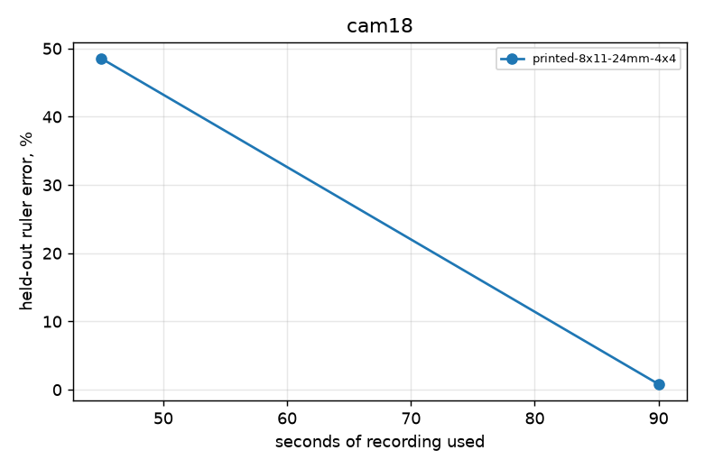

### Where each board is still found

Board poses known from the other cameras, fully inside a camera's image: was it found there?

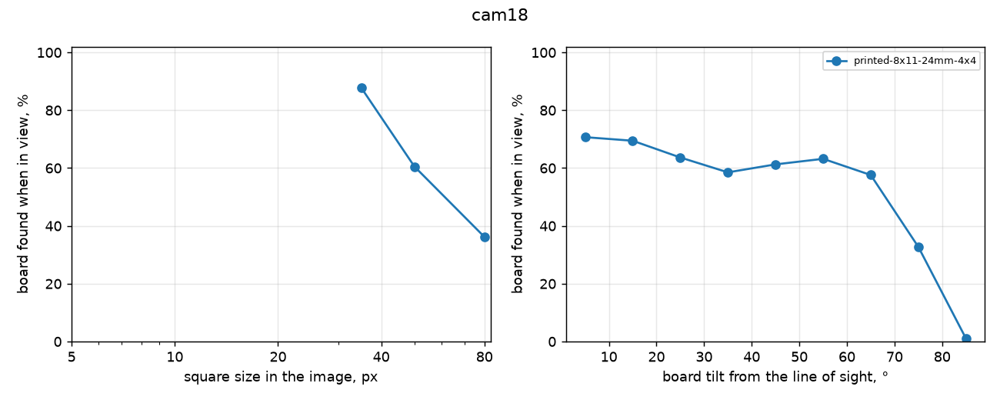

### Repeatability

| Board | Repeats | Engine | 3D spread (median / p95) | Camera position spread (median / worst) | Camera angle spread | Camera distance SD | Focal SD | k1 SD |
|---|---|---|---|---|---|---|---|---|
| printed-8x11-24mm-4x4 | 3 disjoint parts of one recording: cam18-2024-11-19 | anipose | 0.53 / 2.55 mm | 3.8 / 11.2 mm | 0.22° | 4.2 mm | 0.66 % | 0.008 |
| printed-8x11-24mm-4x4 | 3 disjoint parts of one recording: cam18-2024-12-06 | anipose | 0.36 / 1.64 mm | 2.8 / 5.6 mm | 0.15° | 2.9 mm | 0.64 % | 0.012 |

### Calibration tools on the same recordings

| Recording | Tool | Reprojection | Held-out reprojection | Ruler error | Board fit |
|---|---|---|---|---|---|
| cam18-2024-11-19 | anipose | 1.87 px | – | – | – |
| cam18-2024-11-19 | reference | 1.97 px | – | – | – |
| cam18-2024-12-06 | anipose | 1.26 px | – | – | – |
| cam18-2024-12-06 | reference | 1.49 px | – | – | – |

### Recordings

| Recording | Board | Length | Board found per camera |
|---|---|---|---|
| cam18-2024-12-06 (calibration) | printed-8x11-24mm-4x4 | 180 s | 40, 53, 40, 42, 37, 40, 38, 50, 54, 43, 40, 38, 54, 36, 43, 40, 40 % |
| cam18-2024-11-19 (calibration) | printed-8x11-24mm-4x4 | 150 s | 33, 34, 60, 59, 44, 55, 37, 51, 51, 66, 38, 34, 67, 47, 39, 27, 36, 64 % |

## cd1f10

5 cameras, 1280×1024 px, 10 fps. Recordings: 1 calibration, 0 test.

### Per board

Reprojection and held-out reprojection: median pixels. Ruler error: median error of lengths between far-apart corners of the board, triangulated from held-out frames, % of the length. Board fit: RMS distance of triangulated corners from the printed pattern, mm. 3D spread: how far the same 3D points move between repeated calibrations, mm (median). Camera spread: camera-position spread between repeats, mm. Focal spread: SD of focal length, %. Smallest squares found: 5th percentile of square size, in pixels, among detections. Repeats are separate recordings of one sitting when there are several, else 3 disjoint parts of each recording; with several recordings the spread columns show median (min–max).

| Board | Recordings | Board found | Reprojection | Held-out reprojection | Ruler error | Board fit | 3D spread | Camera spread | Focal spread | Smallest squares found | Steepest tilt found |
|---|---|---|---|---|---|---|---|---|---|---|---|
| printed-8x11-24mm-4x4 | 1 | 59 % | 0.33 px | 0.34 px | 0.146 % | 0.52 mm | 0.35 mm | 1.4 mm | 0.56 % | 37 px | 66° |

### How long to record

Held-out ruler error (%) of a calibration from only the first N seconds of a recording:

| Board | 10 s | whole |
|---|---|---|
| printed-8x11-24mm-4x4 | 0.134 | – |

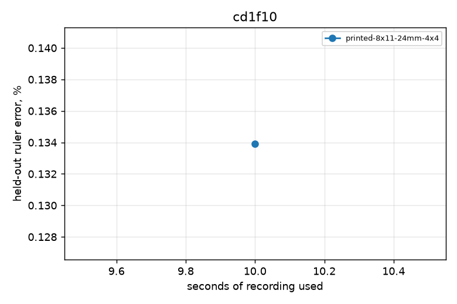

### Where each board is still found

Board poses known from the other cameras, fully inside a camera's image: was it found there?

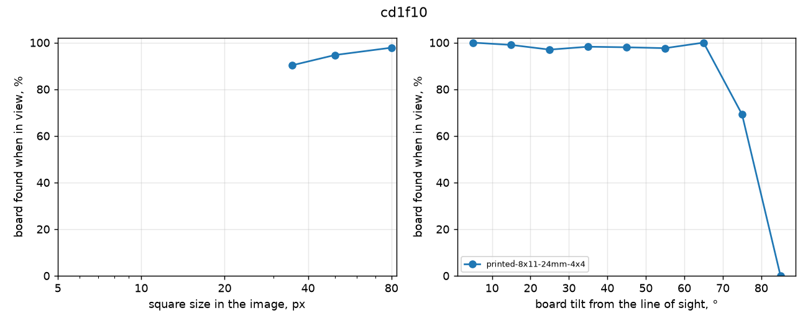

### Repeatability

| Board | Repeats | Engine | 3D spread (median / p95) | Camera position spread (median / worst) | Camera angle spread | Camera distance SD | Focal SD | k1 SD |
|---|---|---|---|---|---|---|---|---|
| printed-8x11-24mm-4x4 | 3 disjoint parts of one recording: cd1f10-2024-07-21 | anipose | 0.35 / 0.99 mm | 1.4 / 2.2 mm | 0.39° | 2.2 mm | 0.56 % | 0.008 |

### Calibration tools on the same recordings

| Recording | Tool | Reprojection | Held-out reprojection | Ruler error | Board fit |
|---|---|---|---|---|---|
| cd1f10-2024-07-21 | anipose | 0.33 px | – | – | – |
| cd1f10-2024-07-21 | reference | 0.61 px | – | – | – |

### Proofread poses

Proofread 2D poses of the same day triangulated with each calibration (median over all labelled nodes of every session listed in the study): reprojection, and leave-one-camera-out (triangulated from the other cameras, projected into the left-out one). Label noise is in both.

| Calibration | Frames used | Pose reprojection | Leave one camera out |
|---|---|---|---|
| cd1f10-2024-07-21 anipose/full | 135 | 2.12 px | 3.70 px |
| cd1f10-2024-07-21 reference/full | 135 | 2.16 px | 3.83 px |
| cd1f10-2024-07-21 anipose/split1of3 | 100 | 2.25 px | 3.86 px |
| cd1f10-2024-07-21 anipose/split2of3 | 73 | 2.15 px | 3.73 px |
| cd1f10-2024-07-21 anipose/split3of3 | 50 | 2.08 px | 3.64 px |
| cd1f10-2024-07-21 anipose/first10s | 100 | 2.15 px | 3.73 px |

### Recordings

| Recording | Board | Length | Board found per camera |
|---|---|---|---|
| cd1f10-2024-07-21 (calibration) | printed-8x11-24mm-4x4 | 22 s | 49, 61, 61, 59, 52 % |

## chronicrecord

4 cameras, 1280×1024 px, 10 fps. Recordings: 1 calibration, 0 test.

### Per board

Reprojection and held-out reprojection: median pixels. Ruler error: median error of lengths between far-apart corners of the board, triangulated from held-out frames, % of the length. Board fit: RMS distance of triangulated corners from the printed pattern, mm. 3D spread: how far the same 3D points move between repeated calibrations, mm (median). Camera spread: camera-position spread between repeats, mm. Focal spread: SD of focal length, %. Smallest squares found: 5th percentile of square size, in pixels, among detections. Repeats are separate recordings of one sitting when there are several, else 3 disjoint parts of each recording; with several recordings the spread columns show median (min–max).

| Board | Recordings | Board found | Reprojection | Held-out reprojection | Ruler error | Board fit | 3D spread | Camera spread | Focal spread | Smallest squares found | Steepest tilt found |
|---|---|---|---|---|---|---|---|---|---|---|---|
| 300×200 coarse (14×9, 20 mm) | 1 | 92 % | 0.23 px | 0.23 px | 0.123 % | 0.42 mm | 0.04 mm | 0.3 mm | 0.09 % | 47 px | 45° |

### How long to record

Held-out ruler error (%) of a calibration from only the first N seconds of a recording:

| Board | 10 s | 20 s | 30 s | whole |
|---|---|---|---|---|
| 300×200 coarse (14×9, 20 mm) | 0.116 | 0.093 | 0.105 | – |

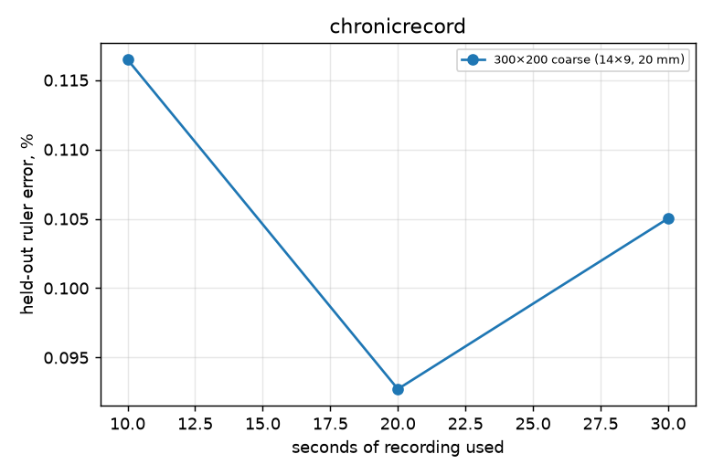

### Where each board is still found

Board poses known from the other cameras, fully inside a camera's image: was it found there?

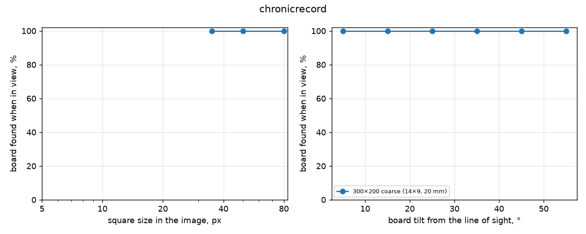

### Repeatability

| Board | Repeats | Engine | 3D spread (median / p95) | Camera position spread (median / worst) | Camera angle spread | Camera distance SD | Focal SD | k1 SD |
|---|---|---|---|---|---|---|---|---|
| 300×200 coarse (14×9, 20 mm) | 3 disjoint parts of one recording: chronicrecord-2026-10-26 | anipose | 0.04 / 0.17 mm | 0.3 / 0.3 mm | 0.10° | 0.3 mm | 0.09 % | 0.002 |

### Calibration tools on the same recordings

| Recording | Tool | Reprojection | Held-out reprojection | Ruler error | Board fit |
|---|---|---|---|---|---|
| chronicrecord-2026-10-26 | anipose | 0.23 px | – | – | – |
| chronicrecord-2026-10-26 | calibrat3 | 0.30 px | – | – | – |
| chronicrecord-2026-10-26 | reference | 0.30 px | – | – | – |

### Recordings

| Recording | Board | Length | Board found per camera |
|---|---|---|---|
| chronicrecord-2026-10-26 (calibration) | 300×200 coarse (14×9, 20 mm) | 60 s | 94, 92, 92, 92 % |

## marmoset10

10 cameras, 1200×1200 px, 10 fps. Recordings: 1 calibration, 0 test.

### Per board

Reprojection and held-out reprojection: median pixels. Ruler error: median error of lengths between far-apart corners of the board, triangulated from held-out frames, % of the length. Board fit: RMS distance of triangulated corners from the printed pattern, mm. 3D spread: how far the same 3D points move between repeated calibrations, mm (median). Camera spread: camera-position spread between repeats, mm. Focal spread: SD of focal length, %. Smallest squares found: 5th percentile of square size, in pixels, among detections. Repeats are separate recordings of one sitting when there are several, else 3 disjoint parts of each recording; with several recordings the spread columns show median (min–max).

| Board | Recordings | Board found | Reprojection | Held-out reprojection | Ruler error | Board fit | 3D spread | Camera spread | Focal spread | Smallest squares found | Steepest tilt found |
|---|---|---|---|---|---|---|---|---|---|---|---|
| 600×400 coarse (14×9, 40 mm) | 1 | 39 % | 0.49 px | 0.58 px | 0.265 % | 1.22 mm | 0.90 mm | 15.5 mm | 1.17 % | 44 px | 64° |

### Where each board is still found

Board poses known from the other cameras, fully inside a camera's image: was it found there?

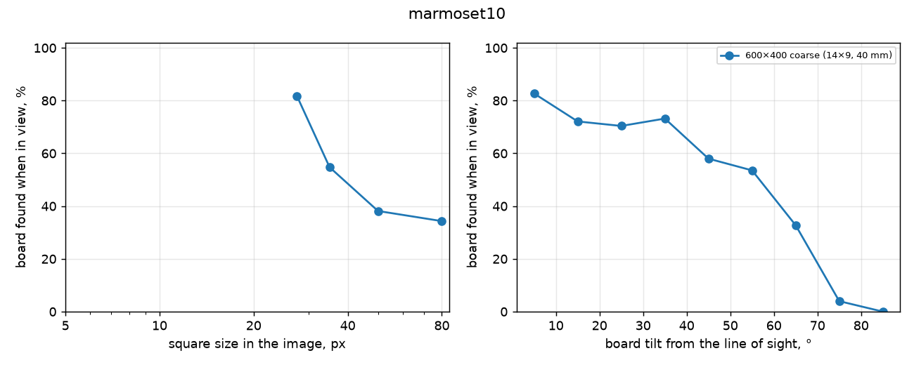

### Repeatability

| Board | Repeats | Engine | 3D spread (median / p95) | Camera position spread (median / worst) | Camera angle spread | Camera distance SD | Focal SD | k1 SD |
|---|---|---|---|---|---|---|---|---|
| 600×400 coarse (14×9, 40 mm) | 3 disjoint parts of one recording: marmoset10-2026-07-21 | anipose | 0.90 / 2.86 mm | 15.5 / 36.1 mm | 0.45° | 17.3 mm | 1.17 % | 0.021 |

### Calibration tools on the same recordings

| Recording | Tool | Reprojection | Held-out reprojection | Ruler error | Board fit |
|---|---|---|---|---|---|
| marmoset10-2026-07-21 | anipose | 0.49 px | – | – | – |
| marmoset10-2026-07-21 | reference | 0.15 px | – | – | – |

### Recordings

| Recording | Board | Length | Board found per camera |
|---|---|---|---|
| marmoset10-2026-07-21 (calibration) | 600×400 coarse (14×9, 40 mm) | 60 s | 11, 52, 59, 48, 20, 15, 16, 33, 46, 58 % |

## marmoset5

5 cameras, 1680×1200 px, 5 fps. Recordings: 1 calibration, 0 test.

### Per board

Reprojection and held-out reprojection: median pixels. Ruler error: median error of lengths between far-apart corners of the board, triangulated from held-out frames, % of the length. Board fit: RMS distance of triangulated corners from the printed pattern, mm. 3D spread: how far the same 3D points move between repeated calibrations, mm (median). Camera spread: camera-position spread between repeats, mm. Focal spread: SD of focal length, %. Smallest squares found: 5th percentile of square size, in pixels, among detections. Repeats are separate recordings of one sitting when there are several, else 3 disjoint parts of each recording; with several recordings the spread columns show median (min–max).

| Board | Recordings | Board found | Reprojection | Held-out reprojection | Ruler error | Board fit | 3D spread | Camera spread | Focal spread | Smallest squares found | Steepest tilt found |
|---|---|---|---|---|---|---|---|---|---|---|---|
| 400×300 coarse (12×9, 30 mm) | 1 | 93 % | 1.03 px | 1.23 px | 1.083 % | 4.45 mm | 8.14 mm | 8.6 mm | 2.13 % | 45 px | 70° |

### How long to record

Held-out ruler error (%) of a calibration from only the first N seconds of a recording:

| Board | 10 s | 20 s | 30 s | whole |
|---|---|---|---|---|
| 400×300 coarse (12×9, 30 mm) | 0.874 | 0.587 | 0.899 | – |

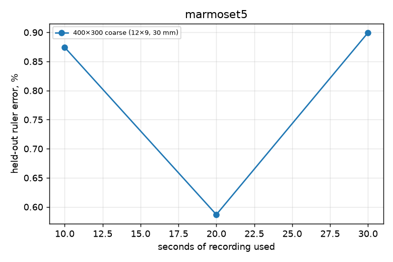

### Where each board is still found

Board poses known from the other cameras, fully inside a camera's image: was it found there?

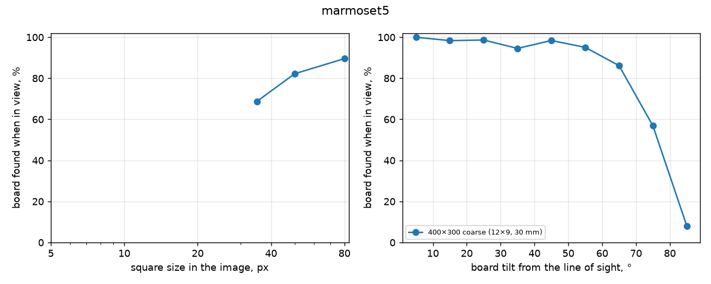

### Repeatability

| Board | Repeats | Engine | 3D spread (median / p95) | Camera position spread (median / worst) | Camera angle spread | Camera distance SD | Focal SD | k1 SD |
|---|---|---|---|---|---|---|---|---|
| 400×300 coarse (12×9, 30 mm) | 3 disjoint parts of one recording: marmoset5-2025-04-01 | anipose | 8.14 / 38.73 mm | 8.6 / 10.9 mm | 0.98° | 12.4 mm | 2.13 % | 0.025 |

### Calibration tools on the same recordings

| Recording | Tool | Reprojection | Held-out reprojection | Ruler error | Board fit |
|---|---|---|---|---|---|
| marmoset5-2025-04-01 | anipose | 1.03 px | – | – | – |
| marmoset5-2025-04-01 | reference | 0.93 px | – | – | – |

### Recordings

| Recording | Board | Length | Board found per camera |
|---|---|---|---|
| marmoset5-2025-04-01 (calibration) | 400×300 coarse (12×9, 30 mm) | 60 s | 68, 86, 93, 98, 99 % |

## polina

7 cameras, 1520×1040 px, 40 fps. Recordings: 2 calibration, 0 test.

### Per board

Reprojection and held-out reprojection: median pixels. Ruler error: median error of lengths between far-apart corners of the board, triangulated from held-out frames, % of the length. Board fit: RMS distance of triangulated corners from the printed pattern, mm. 3D spread: how far the same 3D points move between repeated calibrations, mm (median). Camera spread: camera-position spread between repeats, mm. Focal spread: SD of focal length, %. Smallest squares found: 5th percentile of square size, in pixels, among detections. Repeats are separate recordings of one sitting when there are several, else 3 disjoint parts of each recording; with several recordings the spread columns show median (min–max).

| Board | Recordings | Board found | Reprojection | Held-out reprojection | Ruler error | Board fit | 3D spread | Camera spread | Focal spread | Smallest squares found | Steepest tilt found |
|---|---|---|---|---|---|---|---|---|---|---|---|
| 300×200 coarse (14×9, 20 mm) | 2 | 72 % | 1.05 px | 1.08 px | 0.615 % | 1.35 mm | 0.73 mm (0.43–1.03) | 4.5 mm (4.3–4.8) | 1.14 % (0.89–1.38) | 47 px | 74° |

### How long to record

Held-out ruler error (%) of a calibration from only the first N seconds of a recording:

| Board | 10 s | 20 s | whole |
|---|---|---|---|
| 300×200 coarse (14×9, 20 mm) | 0.572 | 0.811 | – |

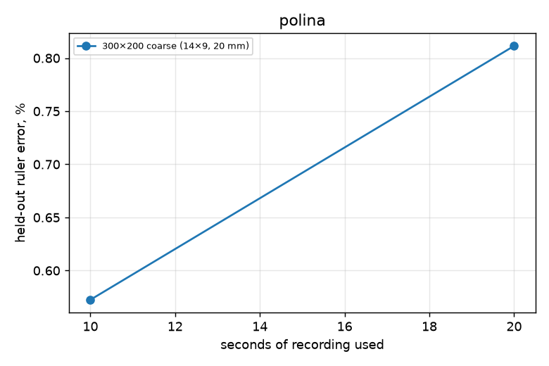

### Where each board is still found

Board poses known from the other cameras, fully inside a camera's image: was it found there?

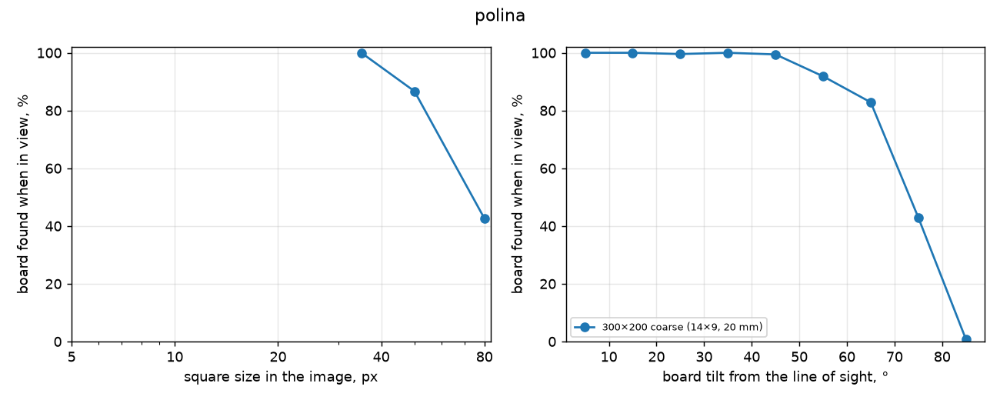

### Repeatability

| Board | Repeats | Engine | 3D spread (median / p95) | Camera position spread (median / worst) | Camera angle spread | Camera distance SD | Focal SD | k1 SD |
|---|---|---|---|---|---|---|---|---|
| 300×200 coarse (14×9, 20 mm) | 3 disjoint parts of one recording: polina-end | anipose | 1.03 / 3.69 mm | 4.8 / 11.1 mm | 1.55° | 6.9 mm | 1.38 % | 0.034 |
| 300×200 coarse (14×9, 20 mm) | 3 disjoint parts of one recording: polina-start | anipose | 0.43 / 1.32 mm | 4.3 / 5.4 mm | 0.77° | 3.7 mm | 0.89 % | 0.017 |

### Calibration tools on the same recordings

| Recording | Tool | Reprojection | Held-out reprojection | Ruler error | Board fit |
|---|---|---|---|---|---|
| polina-end | anipose | 0.97 px | – | – | – |
| polina-end | reference | 25.55 px | – | – | – |
| polina-start | anipose | 1.14 px | – | – | – |
| polina-start | reference | 4.41 px | – | – | – |

### Recordings

| Recording | Board | Length | Board found per camera |
|---|---|---|---|
| polina-start (calibration) | 300×200 coarse (14×9, 20 mm) | 38 s | 75, 22, 92, 44, 89, 22, 87 % |
| polina-end (calibration) | 300×200 coarse (14×9, 20 mm) | 36 s | 69, 34, 92, 55, 92, 32, 92 % |

## rig205

3 cameras, 1280×1024 px, 120 fps. Recordings: 2 calibration, 0 test.

### Per board

Reprojection and held-out reprojection: median pixels. Ruler error: median error of lengths between far-apart corners of the board, triangulated from held-out frames, % of the length. Board fit: RMS distance of triangulated corners from the printed pattern, mm. 3D spread: how far the same 3D points move between repeated calibrations, mm (median). Camera spread: camera-position spread between repeats, mm. Focal spread: SD of focal length, %. Smallest squares found: 5th percentile of square size, in pixels, among detections. Repeats are separate recordings of one sitting when there are several, else 3 disjoint parts of each recording; with several recordings the spread columns show median (min–max).

| Board | Recordings | Board found | Reprojection | Held-out reprojection | Ruler error | Board fit | 3D spread | Camera spread | Focal spread | Smallest squares found | Steepest tilt found |
|---|---|---|---|---|---|---|---|---|---|---|---|
| printed-8x11-24mm-4x4 | 2 | 25 % | 0.39 px | 0.58 px | 2.220 % | 2.58 mm | 5.35 mm (4.59–6.11) | 11.8 mm (8.5–15.0) | 2.81 % (1.11–4.52) | 34 px | 59° |

### How long to record

Held-out ruler error (%) of a calibration from only the first N seconds of a recording:

| Board | 20 s | 30 s | 45 s | whole |
|---|---|---|---|---|
| printed-8x11-24mm-4x4 | 1.782 | 1.935 | 1.591 | – |

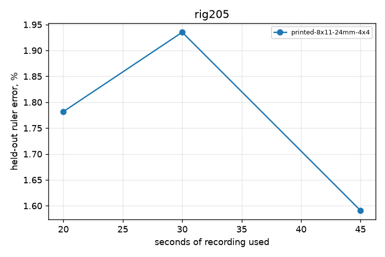

### Where each board is still found

Board poses known from the other cameras, fully inside a camera's image: was it found there?

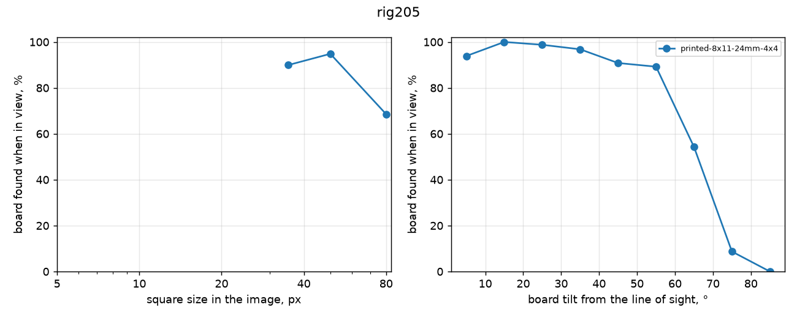

### Repeatability

| Board | Repeats | Engine | 3D spread (median / p95) | Camera position spread (median / worst) | Camera angle spread | Camera distance SD | Focal SD | k1 SD |
|---|---|---|---|---|---|---|---|---|
| printed-8x11-24mm-4x4 | 3 disjoint parts of one recording: rig205-2024-06-06 | anipose | 4.59 / 26.23 mm | 8.5 / 13.7 mm | 3.10° | 19.2 mm | 1.11 % | 0.035 |
| printed-8x11-24mm-4x4 | 3 disjoint parts of one recording: rig205-2024-06-07 | anipose | 6.11 / 19.07 mm | 15.0 / 22.5 mm | 5.58° | 29.1 mm | 4.52 % | 0.016 |

### Calibration tools on the same recordings

| Recording | Tool | Reprojection | Held-out reprojection | Ruler error | Board fit |
|---|---|---|---|---|---|
| rig205-2024-06-06 | anipose | 0.41 px | – | – | – |
| rig205-2024-06-06 | reference | 0.38 px | – | – | – |
| rig205-2024-06-07 | anipose | 0.37 px | – | – | – |

### Recordings

| Recording | Board | Length | Board found per camera |
|---|---|---|---|
| rig205-2024-06-06 (calibration) | printed-8x11-24mm-4x4 | 88 s | 23, 43, 46 % |
| rig205-2024-06-07 (calibration) | printed-8x11-24mm-4x4 | 155 s | 3, 7, 7 % |

## rig8

8 cameras, 1280×1024 px, 10 fps. Recordings: 3 calibration, 0 test.

### Per board

Reprojection and held-out reprojection: median pixels. Ruler error: median error of lengths between far-apart corners of the board, triangulated from held-out frames, % of the length. Board fit: RMS distance of triangulated corners from the printed pattern, mm. 3D spread: how far the same 3D points move between repeated calibrations, mm (median). Camera spread: camera-position spread between repeats, mm. Focal spread: SD of focal length, %. Smallest squares found: 5th percentile of square size, in pixels, among detections. Repeats are separate recordings of one sitting when there are several, else 3 disjoint parts of each recording; with several recordings the spread columns show median (min–max).

| Board | Recordings | Board found | Reprojection | Held-out reprojection | Ruler error | Board fit | 3D spread | Camera spread | Focal spread | Smallest squares found | Steepest tilt found |
|---|---|---|---|---|---|---|---|---|---|---|---|
| 300×200 coarse (14×9, 20 mm) | 1 | 100 % | 0.32 px | 0.33 px | 0.124 % | 0.35 mm | 0.13 mm | 0.6 mm | 0.12 % | 28 px | 50° |
| printed-8x11-24mm-4x4 | 2 | 89 % | 0.21 px | 0.19 px | 0.132 % | 0.30 mm | 0.86 mm (0.05–1.66) | 5,194.0 mm (0.7–10,387.4) | 7.64 % (0.14–15.14) | 40 px | 58° |

### How long to record

Held-out ruler error (%) of a calibration from only the first N seconds of a recording:

| Board | 10 s | 20 s | 30 s | 45 s | 60 s | whole |
|---|---|---|---|---|---|---|
| 300×200 coarse (14×9, 20 mm) | 0.336 | 0.130 | 0.186 | 0.179 | 0.149 | – |
| printed-8x11-24mm-4x4 | 0.145 | 0.156 | – | – | – | – |

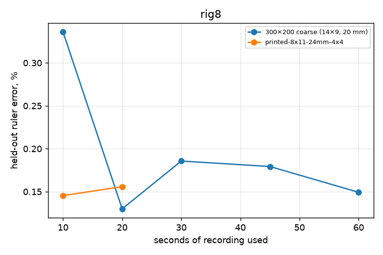

### Where each board is still found

Board poses known from the other cameras, fully inside a camera's image: was it found there?

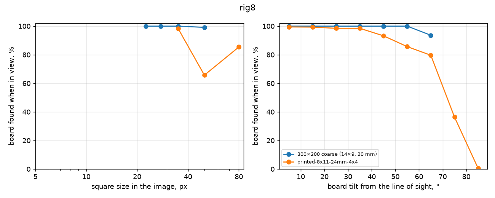

### Repeatability

| Board | Repeats | Engine | 3D spread (median / p95) | Camera position spread (median / worst) | Camera angle spread | Camera distance SD | Focal SD | k1 SD |
|---|---|---|---|---|---|---|---|---|
| 300×200 coarse (14×9, 20 mm) | 3 disjoint parts of one recording: rig8-2026-05-06 | anipose | 0.13 / 0.42 mm | 0.6 / 1.1 mm | 0.27° | 0.5 mm | 0.12 % | 0.005 |
| printed-8x11-24mm-4x4 | 3 disjoint parts of one recording: rig8-2026-03-19 | anipose | 0.05 / 0.15 mm | 0.7 / 1.1 mm | 0.09° | 0.8 mm | 0.14 % | 0.004 |
| printed-8x11-24mm-4x4 | 3 disjoint parts of one recording: rig8-2026-04-28 | anipose | 1.66 / 4.26 mm | 10,387.4 / 72,337.1 mm | 110.15° | 91.4 mm | 15.14 % | 0.127 |

### Calibration tools on the same recordings

| Recording | Tool | Reprojection | Held-out reprojection | Ruler error | Board fit |
|---|---|---|---|---|---|
| rig8-2026-03-19 | anipose | 0.18 px | – | – | – |
| rig8-2026-03-19 | reference | 0.38 px | – | – | – |
| rig8-2026-04-28 | anipose | 0.23 px | – | – | – |
| rig8-2026-04-28 | reference | 0.48 px | – | – | – |
| rig8-2026-05-06 | anipose | 0.32 px | – | – | – |
| rig8-2026-05-06 | reference | 0.41 px | – | – | – |

### Recordings

| Recording | Board | Length | Board found per camera |
|---|---|---|---|
| rig8-2026-03-19 (calibration) | printed-8x11-24mm-4x4 | 30 s | 66, 94, 92, 97, 44, 99, 25, 32 % |
| rig8-2026-04-28 (calibration) | printed-8x11-24mm-4x4 | 30 s | 98, 100, 100, 100, 100, 52, 60, 84 % |
| rig8-2026-05-06 (calibration) | 300×200 coarse (14×9, 20 mm) | 120 s | 100, 100, 100, 100, 100, 100, 99, 100 % |

## slap

8 cameras, 1280×1024 px, 30 fps. Recordings: 2 calibration, 0 test.

### Per board

Reprojection and held-out reprojection: median pixels. Ruler error: median error of lengths between far-apart corners of the board, triangulated from held-out frames, % of the length. Board fit: RMS distance of triangulated corners from the printed pattern, mm. 3D spread: how far the same 3D points move between repeated calibrations, mm (median). Camera spread: camera-position spread between repeats, mm. Focal spread: SD of focal length, %. Smallest squares found: 5th percentile of square size, in pixels, among detections. Repeats are separate recordings of one sitting when there are several, else 3 disjoint parts of each recording; with several recordings the spread columns show median (min–max).

| Board | Recordings | Board found | Reprojection | Held-out reprojection | Ruler error | Board fit | 3D spread | Camera spread | Focal spread | Smallest squares found | Steepest tilt found |
|---|---|---|---|---|---|---|---|---|---|---|---|
| printed-8x11-24mm-4x4 | 2 | 99 % | 0.31 px | 0.33 px | 0.212 % | 0.60 mm | 0.84 mm (0.62–1.06) | 1.1 mm (1.0–1.1) | 0.29 % (0.27–0.31) | 27 px | 58° |

### How long to record

Held-out ruler error (%) of a calibration from only the first N seconds of a recording:

| Board | 10 s | 20 s | 30 s | 45 s | 60 s | whole |
|---|---|---|---|---|---|---|
| printed-8x11-24mm-4x4 | 0.276 | 0.387 | 0.214 | 0.168 | 0.165 | – |

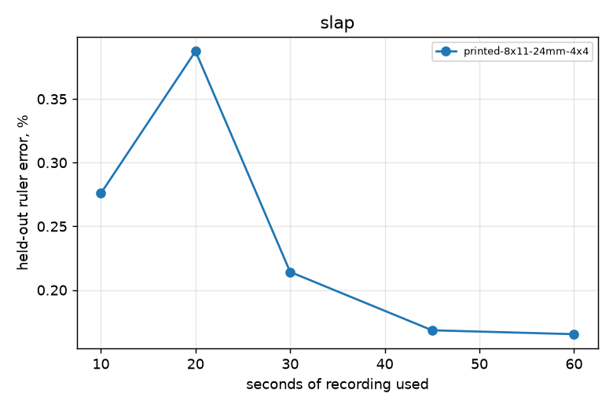

### Where each board is still found

Board poses known from the other cameras, fully inside a camera's image: was it found there?

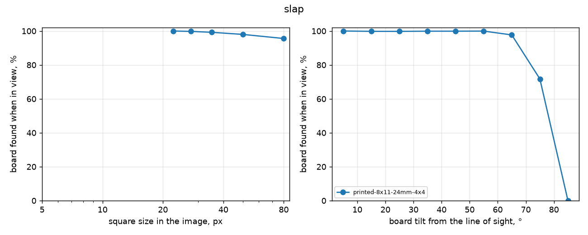

### Repeatability

| Board | Repeats | Engine | 3D spread (median / p95) | Camera position spread (median / worst) | Camera angle spread | Camera distance SD | Focal SD | k1 SD |
|---|---|---|---|---|---|---|---|---|
| printed-8x11-24mm-4x4 | 3 disjoint parts of one recording: slap-2022-10-07 | anipose | 0.62 / 1.33 mm | 1.1 / 1.6 mm | 0.26° | 1.4 mm | 0.27 % | 0.005 |
| printed-8x11-24mm-4x4 | 3 disjoint parts of one recording: slap-2022-10-19 | anipose | 1.06 / 4.29 mm | 1.0 / 2.2 mm | 0.19° | 1.2 mm | 0.31 % | 0.009 |

### Calibration tools on the same recordings

| Recording | Tool | Reprojection | Held-out reprojection | Ruler error | Board fit |
|---|---|---|---|---|---|
| slap-2022-10-07 | anipose | 0.29 px | – | – | – |
| slap-2022-10-07 | reference | 0.55 px | – | – | – |
| slap-2022-10-19 | anipose | 0.33 px | – | – | – |
| slap-2022-10-19 | reference | 0.59 px | – | – | – |

### Proofread poses

Proofread 2D poses of the same day triangulated with each calibration (median over all labelled nodes of every session listed in the study): reprojection, and leave-one-camera-out (triangulated from the other cameras, projected into the left-out one). Label noise is in both.

| Calibration | Frames used | Pose reprojection | Leave one camera out |
|---|---|---|---|
| slap-2022-10-19 anipose/full | 923 | 2.66 px | 3.99 px |
| slap-2022-10-19 reference/full | 923 | 2.74 px | 4.12 px |
| slap-2022-10-19 anipose/split1of3 | 323 | 2.65 px | 3.98 px |
| slap-2022-10-19 anipose/split2of3 | 300 | 2.65 px | 3.98 px |
| slap-2022-10-19 anipose/split3of3 | 300 | 2.68 px | 4.04 px |
| slap-2022-10-19 anipose/first10s | 101 | 2.73 px | 4.11 px |
| slap-2022-10-19 anipose/first20s | 201 | 2.66 px | 3.99 px |
| slap-2022-10-19 anipose/first30s | 301 | 2.66 px | 4.00 px |
| slap-2022-10-19 anipose/first45s | 451 | 2.66 px | 3.99 px |
| slap-2022-10-19 anipose/first60s | 601 | 2.66 px | 3.99 px |

### Recordings

| Recording | Board | Length | Board found per camera |
|---|---|---|---|
| slap-2022-10-19 (calibration) | printed-8x11-24mm-4x4 | 92 s | 100, 100, 100, 100, 95, 96, 100, 100 % |
| slap-2022-10-07 (calibration) | printed-8x11-24mm-4x4 | 90 s | 95, 97, 98, 98, 98, 98, 98, 98 % |

