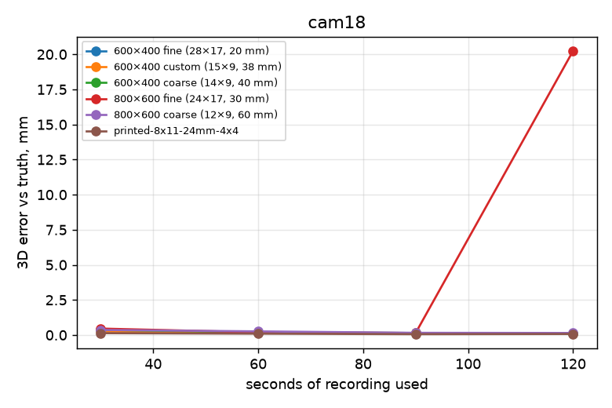
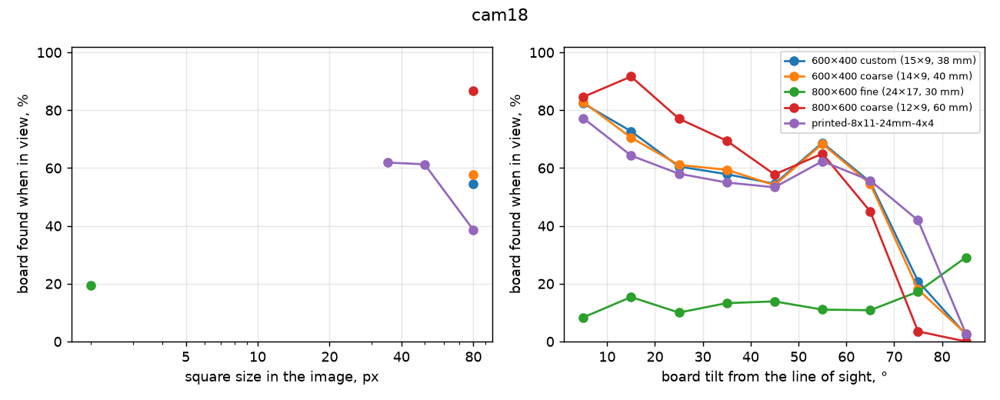

# Calibration board comparison: Simulated cam18

Made 2026-10-29 09:07 by `scripts/board_study`. All numbers are measured with one detector (OpenCV ChArUco) on every calibration, so they compare across boards and calibration tools, but they are not the numbers calibrat3 or sleap-anipose print. Held-out = recordings (or parts of a recording) the calibration did not use.

Synthetic recordings (scripts/board_study/simulate.py) of a copy of the cam18 rig from cam18-2024-12-06__anipose__full.toml; motion from a real recording (cam18-2024-12-06).

## cam18

17 cameras, 1680×1200 px, 1 fps. Recordings: 6 calibration, 1 test.

### Per board

Reprojection and held-out reprojection: median pixels. Ruler error: median error of lengths between far-apart corners of the board, triangulated from held-out frames, % of the length. Board fit: RMS distance of triangulated corners from the printed pattern, mm. 3D spread: how far the same 3D points move between repeated calibrations, mm (median). Camera spread: camera-position spread between repeats, mm. Focal spread: SD of focal length, %. Smallest squares found: 5th percentile of square size, in pixels, among detections. Repeats are separate recordings of one sitting when there are several, else 3 disjoint parts of each recording; with several recordings the spread columns show median (min–max).

| Board | Recordings | Board found | Reprojection | Held-out reprojection | Ruler error | 3D error vs truth | Board fit | 3D spread | Camera spread | Focal spread | Smallest squares found | Steepest tilt found |
|---|---|---|---|---|---|---|---|---|---|---|---|---|
| 600×400 fine (28×17, 20 mm) | 0 | – | – | 0.30 px | 0.044 % | 0.11 mm | 0.29 mm | 0.01 mm | 0.1 mm | 0.02 % | – | – |
| 600×400 custom (15×9, 38 mm) | 1 | 38 % | 0.29 px | 0.30 px | 0.045 % | 0.13 mm | 0.30 mm | 0.02 mm | 0.2 mm | 0.03 % | 77 px | 74° |
| 600×400 coarse (14×9, 40 mm) | 1 | 38 % | 0.29 px | 0.30 px | 0.050 % | 0.13 mm | 0.30 mm | 0.03 mm | 0.2 mm | 0.03 % | 81 px | 71° |
| 800×600 fine (24×17, 30 mm) | 1 | 33 % | 828.60 px | 491.84 px | 243.911 % | 19,952.81 mm | 2,071.97 mm | 0.02 mm | 0.1 mm | 0.02 % | 0 px | 88° |
| 800×600 coarse (12×9, 60 mm) | 1 | 32 % | 0.26 px | 0.30 px | 0.070 % | 0.14 mm | 0.27 mm | 121.34 mm | 241.3 mm | 2.89 % | 114 px | 66° |
| printed-8x11-24mm-4x4 | 1 | 44 % | 0.29 px | 0.29 px | 0.046 % | 0.07 mm | 0.25 mm | 0.02 mm | 0.1 mm | 0.02 % | 49 px | 76° |

### How long to record

3D error against the true calibration (mm, median) of a calibration from only the first N seconds of a recording:

| Board | 30 s | 60 s | 90 s | 120 s | whole |
|---|---|---|---|---|---|
| 600×400 fine (28×17, 20 mm) | – | – | – | – | – |
| 600×400 custom (15×9, 38 mm) | 0.25 | 0.18 | 0.14 | 0.13 | 0.13 |
| 600×400 coarse (14×9, 40 mm) | 0.37 | 0.19 | 0.15 | 0.14 | 0.13 |
| 800×600 fine (24×17, 30 mm) | 0.46 | 0.19 | 0.14 | 20.24 | 19,952.81 |
| 800×600 coarse (12×9, 60 mm) | 0.36 | 0.26 | 0.16 | 0.15 | 0.14 |
| printed-8x11-24mm-4x4 | 0.13 | 0.10 | 0.06 | 0.08 | 0.07 |

### Where each board is still found

Board poses known from the other cameras, fully inside a camera's image: was it found there?

### Repeatability

| Board | Repeats | Engine | 3D spread (median / p95) | Camera position spread (median / worst) | Camera angle spread | Camera distance SD | Focal SD | k1 SD |
|---|---|---|---|---|---|---|---|---|
| 600×400 fine (28×17, 20 mm) | 3 disjoint parts of one recording: sim-cam18-600x400-fine-1 | anipose | 0.01 / 0.09 mm | 0.1 / 0.3 mm | 0.00° | 0.1 mm | 0.02 % | 0.000 |
| 600×400 custom (15×9, 38 mm) | 3 disjoint parts of one recording: sim-cam18-custom-9x15-38mm-1 | anipose | 0.02 / 0.09 mm | 0.2 / 0.2 mm | 0.01° | 0.2 mm | 0.03 % | 0.000 |
| 600×400 coarse (14×9, 40 mm) | 3 disjoint parts of one recording: sim-cam18-600x400-coarse-1 | anipose | 0.03 / 0.14 mm | 0.2 / 0.3 mm | 0.01° | 0.3 mm | 0.03 % | 0.000 |
| 800×600 fine (24×17, 30 mm) | 3 disjoint parts of one recording: sim-cam18-800x600-fine-1 | anipose | 0.02 / 0.13 mm | 0.1 / 0.3 mm | 0.01° | 0.2 mm | 0.02 % | 0.000 |
| 800×600 coarse (12×9, 60 mm) | 3 disjoint parts of one recording: sim-cam18-800x600-coarse-1 | anipose | 121.34 / 194.31 mm | 241.3 / 322.0 mm | 8.28° | 356.2 mm | 2.89 % | 0.018 |
| printed-8x11-24mm-4x4 | 3 disjoint parts of one recording: sim-cam18-printed-8x11-24mm-4x4-1 | anipose | 0.02 / 0.12 mm | 0.1 / 0.3 mm | 0.01° | 0.1 mm | 0.02 % | 0.000 |

### Recordings

| Recording | Board | Length | Board found per camera |
|---|---|---|---|
| sim-cam18-printed-8x11-24mm-4x4-1 (calibration) | printed-8x11-24mm-4x4 | 180 s | 44, 52, 44, 43, 46, 42, 42, 50, 52, 46, 43, 42, 54, 38, 46, 45, 43 % |
| sim-cam18-600x400-coarse-1 (calibration) | 600×400 coarse (14×9, 40 mm) | 180 s | 38, 42, 35, 40, 38, 34, 37, 46, 44, 43, 37, 33, 48, 34, 38, 37, 35 % |
| sim-cam18-600x400-fine-1 (calibration) | 600×400 fine (28×17, 20 mm) | 180 s | – |
| sim-cam18-800x600-coarse-1 (calibration) | 800×600 coarse (12×9, 60 mm) | 180 s | 34, 26, 30, 38, 34, 28, 32, 40, 31, 39, 32, 24, 35, 24, 28, 32, 27 % |
| sim-cam18-800x600-fine-1 (calibration) | 800×600 fine (24×17, 30 mm) | 180 s | 34, 25, 28, 38, 37, 30, 36, 40, 30, 38, 33, 27, 33, 26, 29, 34, 29 % |
| sim-cam18-custom-9x15-38mm-1 (calibration) | 600×400 custom (15×9, 38 mm) | 180 s | 40, 43, 36, 40, 39, 34, 38, 46, 44, 44, 38, 33, 48, 37, 38, 38, 36 % |
| sim-cam18-test (test) | 600×400 coarse (14×9, 40 mm) | 12 s | – |

Failed calibrations: sim-cam18-600x400-fine-1 anipose: OpenCV(5.0.0) /Users/xperience/GHA-OpenCV-Python/_work/opencv-python/opencv-python/opencv/modules/calib/src/calibration.

