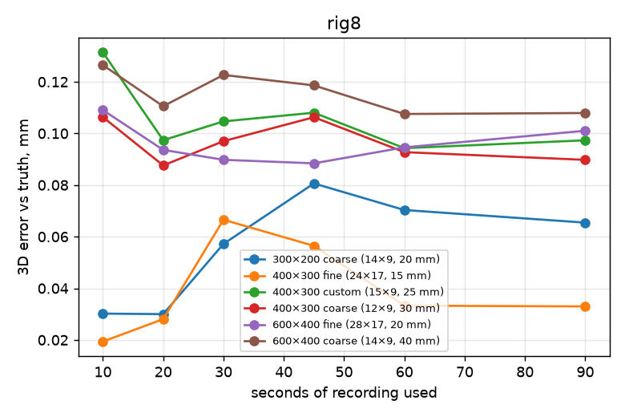
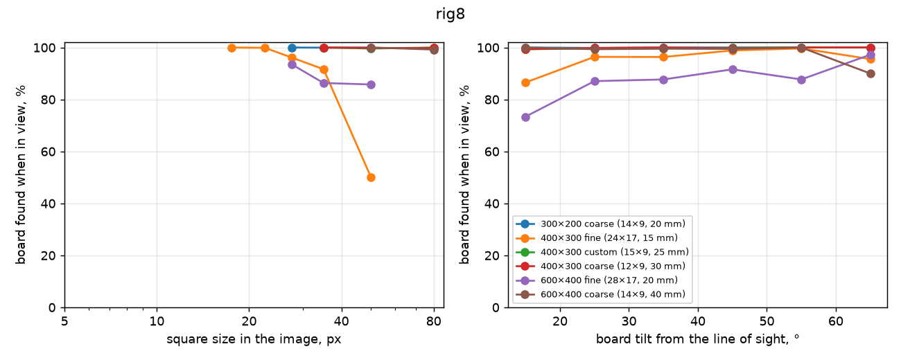

# Calibration board comparison: Simulated rig8

Made 2026-10-29 10:10 by `scripts/board_study`. All numbers are measured with one detector (OpenCV ChArUco) on every calibration, so they compare across boards and calibration tools, but they are not the numbers calibrat3 or sleap-anipose print. Held-out = recordings (or parts of a recording) the calibration did not use.

Synthetic recordings (scripts/board_study/simulate.py) of a copy of the rig8 rig from rig8-2026-05-06__anipose__full.toml; motion from a real recording (rig8-2026-05-06).

## rig8

8 cameras, 1280×1024 px, 2 fps. Recordings: 6 calibration, 1 test.

### Per board

Reprojection and held-out reprojection: median pixels. Ruler error: median error of lengths between far-apart corners of the board, triangulated from held-out frames, % of the length. Board fit: RMS distance of triangulated corners from the printed pattern, mm. 3D spread: how far the same 3D points move between repeated calibrations, mm (median). Camera spread: camera-position spread between repeats, mm. Focal spread: SD of focal length, %. Smallest squares found: 5th percentile of square size, in pixels, among detections. Repeats are separate recordings of one sitting when there are several, else 3 disjoint parts of each recording; with several recordings the spread columns show median (min–max).

| Board | Recordings | Board found | Reprojection | Held-out reprojection | Ruler error | 3D error vs truth | Board fit | 3D spread | Camera spread | Focal spread | Smallest squares found | Steepest tilt found |
|---|---|---|---|---|---|---|---|---|---|---|---|---|
| 300×200 coarse (14×9, 20 mm) | 1 | 100 % | 0.32 px | 0.33 px | 0.068 % | 0.08 mm | 0.25 mm | 0.05 mm | 0.3 mm | 0.06 % | 28 px | 50° |
| 400×300 fine (24×17, 15 mm) | 1 | 98 % | 0.30 px | 0.33 px | 0.068 % | 0.06 mm | 0.23 mm | 0.06 mm | 0.3 mm | 0.07 % | 21 px | 50° |
| 400×300 custom (15×9, 25 mm) | 1 | 100 % | 0.33 px | 0.34 px | 0.076 % | 0.09 mm | 0.27 mm | 0.03 mm | 0.2 mm | 0.03 % | 35 px | 50° |
| 400×300 coarse (12×9, 30 mm) | 1 | 100 % | 0.33 px | 0.34 px | 0.075 % | 0.09 mm | 0.26 mm | 0.02 mm | 0.2 mm | 0.04 % | 42 px | 50° |
| 600×400 fine (28×17, 20 mm) | 1 | 88 % | 0.33 px | 0.34 px | 0.078 % | 0.10 mm | 0.27 mm | 0.02 mm | 0.1 mm | 0.02 % | 28 px | 50° |
| 600×400 coarse (14×9, 40 mm) | 1 | 99 % | 0.34 px | 0.34 px | 0.081 % | 0.10 mm | 0.29 mm | 0.02 mm | 0.1 mm | 0.03 % | 57 px | 50° |

### How long to record

3D error against the true calibration (mm, median) of a calibration from only the first N seconds of a recording:

| Board | 10 s | 20 s | 30 s | 45 s | 60 s | 90 s | whole |
|---|---|---|---|---|---|---|---|
| 300×200 coarse (14×9, 20 mm) | 0.03 | 0.03 | 0.06 | 0.08 | 0.07 | 0.07 | 0.08 |
| 400×300 fine (24×17, 15 mm) | 0.02 | 0.03 | 0.07 | 0.06 | 0.03 | 0.03 | 0.06 |
| 400×300 custom (15×9, 25 mm) | 0.13 | 0.10 | 0.10 | 0.11 | 0.09 | 0.10 | 0.09 |
| 400×300 coarse (12×9, 30 mm) | 0.11 | 0.09 | 0.10 | 0.11 | 0.09 | 0.09 | 0.09 |
| 600×400 fine (28×17, 20 mm) | 0.11 | 0.09 | 0.09 | 0.09 | 0.09 | 0.10 | 0.10 |
| 600×400 coarse (14×9, 40 mm) | 0.13 | 0.11 | 0.12 | 0.12 | 0.11 | 0.11 | 0.10 |

### Where each board is still found

Board poses known from the other cameras, fully inside a camera's image: was it found there?

### Repeatability

| Board | Repeats | Engine | 3D spread (median / p95) | Camera position spread (median / worst) | Camera angle spread | Camera distance SD | Focal SD | k1 SD |
|---|---|---|---|---|---|---|---|---|
| 300×200 coarse (14×9, 20 mm) | 3 disjoint parts of one recording: sim-rig8-300x200-coarse-1 | anipose | 0.05 / 0.28 mm | 0.3 / 0.5 mm | 0.06° | 0.4 mm | 0.06 % | 0.001 |
| 400×300 fine (24×17, 15 mm) | 3 disjoint parts of one recording: sim-rig8-400x300-fine-1 | anipose | 0.06 / 0.27 mm | 0.3 / 0.7 mm | 0.12° | 0.3 mm | 0.07 % | 0.001 |
| 400×300 custom (15×9, 25 mm) | 3 disjoint parts of one recording: sim-rig8-custom-9x15-25mm-1 | anipose | 0.03 / 0.13 mm | 0.2 / 0.3 mm | 0.05° | 0.2 mm | 0.03 % | 0.001 |
| 400×300 coarse (12×9, 30 mm) | 3 disjoint parts of one recording: sim-rig8-400x300-coarse-1 | anipose | 0.02 / 0.16 mm | 0.2 / 0.4 mm | 0.06° | 0.2 mm | 0.04 % | 0.001 |
| 600×400 fine (28×17, 20 mm) | 3 disjoint parts of one recording: sim-rig8-600x400-fine-1 | anipose | 0.02 / 0.09 mm | 0.1 / 0.2 mm | 0.04° | 0.1 mm | 0.02 % | 0.000 |
| 600×400 coarse (14×9, 40 mm) | 3 disjoint parts of one recording: sim-rig8-600x400-coarse-1 | anipose | 0.02 / 0.07 mm | 0.1 / 0.2 mm | 0.05° | 0.1 mm | 0.03 % | 0.000 |

### Recordings

| Recording | Board | Length | Board found per camera |
|---|---|---|---|
| sim-rig8-300x200-coarse-1 (calibration) | 300×200 coarse (14×9, 20 mm) | 120 s | 100, 100, 100, 100, 100, 100, 100, 100 % |
| sim-rig8-400x300-coarse-1 (calibration) | 400×300 coarse (12×9, 30 mm) | 120 s | 100, 100, 100, 100, 99, 100, 100, 99 % |
| sim-rig8-400x300-fine-1 (calibration) | 400×300 fine (24×17, 15 mm) | 120 s | 98, 98, 94, 96, 90, 99, 99, 99 % |
| sim-rig8-600x400-coarse-1 (calibration) | 600×400 coarse (14×9, 40 mm) | 120 s | 99, 98, 99, 100, 100, 99, 100, 99 % |
| sim-rig8-600x400-fine-1 (calibration) | 600×400 fine (28×17, 20 mm) | 120 s | 87, 90, 91, 83, 82, 89, 100, 81 % |
| sim-rig8-custom-9x15-25mm-1 (calibration) | 400×300 custom (15×9, 25 mm) | 120 s | 100, 100, 100, 100, 99, 100, 100, 99 % |
| sim-rig8-test (test) | 400×300 coarse (12×9, 30 mm) | 12 s | – |

