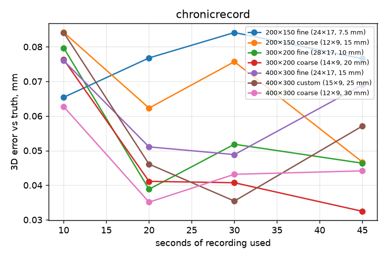
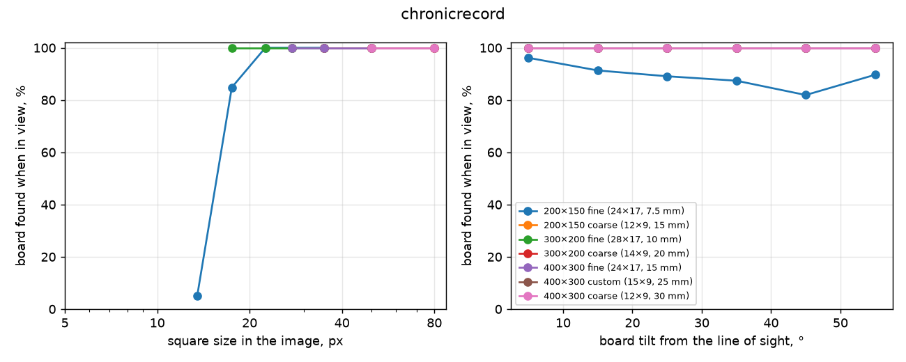

# Calibration board comparison: Simulated chronicrecord

Made 2026-10-29 07:54 by `scripts/board_study`. All numbers are measured with one detector (OpenCV ChArUco) on every calibration, so they compare across boards and calibration tools, but they are not the numbers calibrat3 or sleap-anipose print. Held-out = recordings (or parts of a recording) the calibration did not use.

Synthetic recordings (scripts/board_study/simulate.py) of a copy of the chronicrecord rig from chronicrecord-2026-10-26__anipose__full.toml; motion from a real recording (chronicrecord-2026-10-26).

## chronicrecord

4 cameras, 1280×1024 px, 5 fps. Recordings: 14 calibration, 1 test.

### Per board

Reprojection and held-out reprojection: median pixels. Ruler error: median error of lengths between far-apart corners of the board, triangulated from held-out frames, % of the length. Board fit: RMS distance of triangulated corners from the printed pattern, mm. 3D spread: how far the same 3D points move between repeated calibrations, mm (median). Camera spread: camera-position spread between repeats, mm. Focal spread: SD of focal length, %. Smallest squares found: 5th percentile of square size, in pixels, among detections. Repeats are separate recordings of one sitting when there are several, else 3 disjoint parts of each recording; with several recordings the spread columns show median (min–max).

| Board | Recordings | Board found | Reprojection | Held-out reprojection | Ruler error | 3D error vs truth | Board fit | 3D spread | Camera spread | Focal spread | Smallest squares found | Steepest tilt found |
|---|---|---|---|---|---|---|---|---|---|---|---|---|
| 200×150 fine (24×17, 7.5 mm) | 1 | 93 % | 0.19 px | 0.23 px | 0.074 % | 0.10 mm | 0.26 mm | 0.09 mm (0.08–0.09) | 0.2 mm (0.1–0.2) | 0.05 % (0.05–0.05) | 18 px | 42° |
| 200×150 coarse (12×9, 15 mm) | 2 | 93 % | 0.23 px | 0.23 px | 0.062 % | 0.03 mm | 0.25 mm | 0.03 mm | 0.1 mm | 0.06 % | 35 px | 45° |
| 300×200 fine (28×17, 10 mm) | 2 | 93 % | 0.22 px | 0.23 px | 0.066 % | 0.05 mm | 0.26 mm | 0.03 mm | 0.1 mm | 0.02 % | 23 px | 45° |
| 300×200 coarse (14×9, 20 mm) | 2 | 93 % | 0.24 px | 0.23 px | 0.061 % | 0.03 mm | 0.25 mm | 0.01 mm | 0.0 mm | 0.02 % | 47 px | 45° |
| 400×300 fine (24×17, 15 mm) | 2 | 93 % | 0.24 px | 0.23 px | 0.063 % | 0.04 mm | 0.26 mm | 0.02 mm | 0.1 mm | 0.01 % | 35 px | 44° |
| 400×300 custom (15×9, 25 mm) | 2 | 93 % | 0.23 px | 0.23 px | 0.063 % | 0.04 mm | 0.25 mm | 0.01 mm | 0.0 mm | 0.01 % | 58 px | 44° |
| 400×300 coarse (12×9, 30 mm) | 2 | 93 % | 0.23 px | 0.23 px | 0.064 % | 0.04 mm | 0.25 mm | 0.01 mm | 0.0 mm | 0.02 % | 70 px | 44° |

### How long to record

3D error against the true calibration (mm, median) of a calibration from only the first N seconds of a recording:

| Board | 10 s | 20 s | 30 s | 45 s | whole |
|---|---|---|---|---|---|
| 200×150 fine (24×17, 7.5 mm) | 0.07 | 0.08 | 0.08 | 0.08 | 0.10 |
| 200×150 coarse (12×9, 15 mm) | 0.08 | 0.06 | 0.08 | 0.05 | 0.03 |
| 300×200 fine (28×17, 10 mm) | 0.08 | 0.04 | 0.05 | 0.05 | 0.05 |
| 300×200 coarse (14×9, 20 mm) | 0.08 | 0.04 | 0.04 | 0.03 | 0.03 |
| 400×300 fine (24×17, 15 mm) | 0.08 | 0.05 | 0.05 | 0.07 | 0.04 |
| 400×300 custom (15×9, 25 mm) | 0.08 | 0.05 | 0.04 | 0.06 | 0.04 |
| 400×300 coarse (12×9, 30 mm) | 0.06 | 0.04 | 0.04 | 0.04 | 0.04 |

### Where each board is still found

Board poses known from the other cameras, fully inside a camera's image: was it found there?

### Repeatability

| Board | Repeats | Engine | 3D spread (median / p95) | Camera position spread (median / worst) | Camera angle spread | Camera distance SD | Focal SD | k1 SD |
|---|---|---|---|---|---|---|---|---|
| 200×150 fine (24×17, 7.5 mm) | 3 disjoint parts of one recording: sim-chronicrecord-200x150-fine-1 | anipose | 0.09 / 0.23 mm | 0.2 / 0.2 mm | 0.02° | 0.2 mm | 0.05 % | 0.000 |
| 200×150 fine (24×17, 7.5 mm) | 3 disjoint parts of one recording: sim-chronicrecord-200x150-fine-2 | anipose | 0.08 / 0.20 mm | 0.1 / 0.2 mm | 0.06° | 0.2 mm | 0.05 % | 0.001 |
| 200×150 coarse (12×9, 15 mm) | 3 disjoint parts of one recording: sim-chronicrecord-200x150-coarse-1 | anipose | 0.07 / 0.18 mm | 0.1 / 0.1 mm | 0.03° | 0.1 mm | 0.05 % | 0.001 |
| 200×150 coarse (12×9, 15 mm) | 2 separate recordings: sim-chronicrecord-200x150-coarse-1,sim-chronicrecord-200x150-coarse-2 | anipose | 0.03 / 0.10 mm | 0.1 / 0.2 mm | 0.04° | 0.1 mm | 0.06 % | 0.000 |
| 200×150 coarse (12×9, 15 mm) | 3 disjoint parts of one recording: sim-chronicrecord-200x150-coarse-2 | anipose | 0.04 / 0.10 mm | 0.1 / 0.1 mm | 0.02° | 0.1 mm | 0.04 % | 0.000 |
| 300×200 fine (28×17, 10 mm) | 3 disjoint parts of one recording: sim-chronicrecord-300x200-fine-1 | anipose | 0.03 / 0.07 mm | 0.0 / 0.1 mm | 0.01° | 0.1 mm | 0.02 % | 0.000 |
| 300×200 fine (28×17, 10 mm) | 2 separate recordings: sim-chronicrecord-300x200-fine-1,sim-chronicrecord-300x200-fine-2 | anipose | 0.03 / 0.06 mm | 0.1 / 0.1 mm | 0.02° | 0.1 mm | 0.02 % | 0.000 |
| 300×200 fine (28×17, 10 mm) | 3 disjoint parts of one recording: sim-chronicrecord-300x200-fine-2 | anipose | 0.02 / 0.05 mm | 0.0 / 0.1 mm | 0.02° | 0.0 mm | 0.03 % | 0.000 |
| 300×200 coarse (14×9, 20 mm) | 3 disjoint parts of one recording: sim-chronicrecord-300x200-coarse-1 | anipose | 0.02 / 0.08 mm | 0.1 / 0.1 mm | 0.04° | 0.1 mm | 0.03 % | 0.000 |
| 300×200 coarse (14×9, 20 mm) | 2 separate recordings: sim-chronicrecord-300x200-coarse-1,sim-chronicrecord-300x200-coarse-2 | anipose | 0.01 / 0.03 mm | 0.0 / 0.1 mm | 0.02° | 0.0 mm | 0.02 % | 0.000 |
| 300×200 coarse (14×9, 20 mm) | 3 disjoint parts of one recording: sim-chronicrecord-300x200-coarse-2 | anipose | 0.02 / 0.06 mm | 0.1 / 0.1 mm | 0.01° | 0.1 mm | 0.03 % | 0.000 |
| 400×300 fine (24×17, 15 mm) | 3 disjoint parts of one recording: sim-chronicrecord-400x300-fine-1 | anipose | 0.02 / 0.06 mm | 0.1 / 0.1 mm | 0.03° | 0.1 mm | 0.03 % | 0.000 |
| 400×300 fine (24×17, 15 mm) | 2 separate recordings: sim-chronicrecord-400x300-fine-1,sim-chronicrecord-400x300-fine-2 | anipose | 0.02 / 0.05 mm | 0.1 / 0.1 mm | 0.01° | 0.1 mm | 0.01 % | 0.000 |
| 400×300 fine (24×17, 15 mm) | 3 disjoint parts of one recording: sim-chronicrecord-400x300-fine-2 | anipose | 0.02 / 0.04 mm | 0.0 / 0.1 mm | 0.04° | 0.0 mm | 0.02 % | 0.000 |
| 400×300 custom (15×9, 25 mm) | 3 disjoint parts of one recording: sim-chronicrecord-custom-9x15-25mm-1 | anipose | 0.03 / 0.09 mm | 0.1 / 0.1 mm | 0.04° | 0.2 mm | 0.05 % | 0.000 |
| 400×300 custom (15×9, 25 mm) | 2 separate recordings: sim-chronicrecord-custom-9x15-25mm-1,sim-chronicrecord-custom-9x15-25mm-2 | anipose | 0.01 / 0.05 mm | 0.0 / 0.0 mm | 0.03° | 0.0 mm | 0.01 % | 0.000 |
| 400×300 custom (15×9, 25 mm) | 3 disjoint parts of one recording: sim-chronicrecord-custom-9x15-25mm-2 | anipose | 0.02 / 0.06 mm | 0.0 / 0.1 mm | 0.02° | 0.0 mm | 0.01 % | 0.000 |
| 400×300 coarse (12×9, 30 mm) | 3 disjoint parts of one recording: sim-chronicrecord-400x300-coarse-1 | anipose | 0.05 / 0.12 mm | 0.1 / 0.2 mm | 0.02° | 0.2 mm | 0.04 % | 0.000 |
| 400×300 coarse (12×9, 30 mm) | 2 separate recordings: sim-chronicrecord-400x300-coarse-1,sim-chronicrecord-400x300-coarse-2 | anipose | 0.01 / 0.04 mm | 0.0 / 0.1 mm | 0.02° | 0.1 mm | 0.02 % | 0.000 |
| 400×300 coarse (12×9, 30 mm) | 3 disjoint parts of one recording: sim-chronicrecord-400x300-coarse-2 | anipose | 0.04 / 0.07 mm | 0.1 / 0.1 mm | 0.05° | 0.1 mm | 0.04 % | 0.000 |

### Recordings

| Recording | Board | Length | Board found per camera |
|---|---|---|---|
| sim-chronicrecord-200x150-coarse-1 (calibration) | 200×150 coarse (12×9, 15 mm) | 60 s | 93, 93, 92, 92 % |
| sim-chronicrecord-200x150-coarse-2 (calibration) | 200×150 coarse (12×9, 15 mm) | 60 s | 94, 94, 93, 93 % |
| sim-chronicrecord-200x150-fine-1 (calibration) | 200×150 fine (24×17, 7.5 mm) | 60 s | – |
| sim-chronicrecord-200x150-fine-2 (calibration) | 200×150 fine (24×17, 7.5 mm) | 60 s | 56, 92, 93, 94 % |
| sim-chronicrecord-300x200-coarse-1 (calibration) | 300×200 coarse (14×9, 20 mm) | 60 s | 93, 93, 92, 93 % |
| sim-chronicrecord-300x200-coarse-2 (calibration) | 300×200 coarse (14×9, 20 mm) | 60 s | 94, 94, 93, 94 % |
| sim-chronicrecord-300x200-fine-1 (calibration) | 300×200 fine (28×17, 10 mm) | 60 s | 93, 93, 93, 93 % |
| sim-chronicrecord-300x200-fine-2 (calibration) | 300×200 fine (28×17, 10 mm) | 60 s | 94, 94, 94, 94 % |
| sim-chronicrecord-400x300-coarse-1 (calibration) | 400×300 coarse (12×9, 30 mm) | 60 s | 93, 93, 93, 93 % |
| sim-chronicrecord-400x300-coarse-2 (calibration) | 400×300 coarse (12×9, 30 mm) | 60 s | 94, 94, 94, 94 % |
| sim-chronicrecord-400x300-fine-1 (calibration) | 400×300 fine (24×17, 15 mm) | 60 s | 93, 93, 93, 93 % |
| sim-chronicrecord-400x300-fine-2 (calibration) | 400×300 fine (24×17, 15 mm) | 60 s | 94, 94, 94, 94 % |
| sim-chronicrecord-custom-9x15-25mm-1 (calibration) | 400×300 custom (15×9, 25 mm) | 60 s | 93, 93, 93, 93 % |
| sim-chronicrecord-custom-9x15-25mm-2 (calibration) | 400×300 custom (15×9, 25 mm) | 60 s | 94, 94, 94, 93 % |
| sim-chronicrecord-test (test) | 300×200 coarse (14×9, 20 mm) | 12 s | – |

Failed calibrations: sim-chronicrecord-200x150-fine-1 anipose: OpenCV(5.0.0) /Users/xperience/GHA-OpenCV-Python/_work/opencv-python/opencv-python/opencv/modules/calib/src/calibration.

